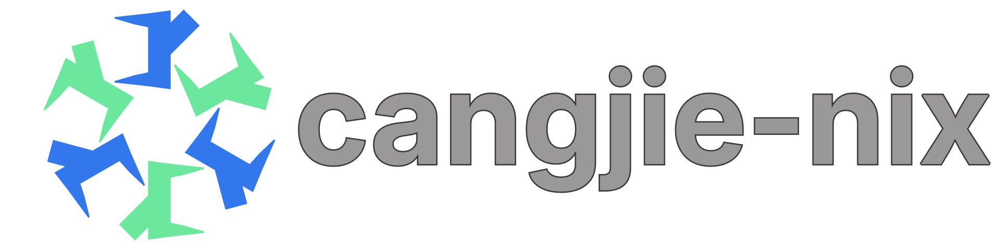

# cangjie-nix



Declarative and reproducible Cangjie packages with Nix.

Features:
- Automatically manages up-to-date Cangjie SDK version.
- Supports SDK and stdx version pinning.

## Platforms

The following cangjie packages are provided.

| system | architecture    | source |
|--------|-----------------|--------|
| linux  | aarch64, x86_64 | bin    |
| mac    | TBD             | TBD    |

> [!NOTE]
> Currently, SDK flavor for cross-compilation is not supported.

> [!NOTE]
> SDK package from git source with local build is not yet supported. Only prebilt artifacts are packaged. 

## Versions

Cangjie is provided from the following up-to-date channels:
- Stable (LTS)
- Nightly

Provided packages:
- `cangjie-nix` which is defaulted to `cangjie-nix.stable`
- `cangjie-nix.stable` which is defaulted to `cangjie-nix.stable.latest`
- `cangjie-nix.nightly` which is defaulted to `cangjie-nix.nightly.latest`

Besides latest SDK, you can pin specific version, like:
- `cangjie-nix.stable."1.0.5"` (format: `major.minor.patch`)
- `cangjie-nix.nightly."2026-11-06"` (format: `yyyy-mm-dd`)
- `cangjie-nix.nightly."1.3.0-alpha.20261106001044"` (format: original version)

Stable versions support:
- `1.0.5` (LTS)

Stdx provides `static` and `dynamic` variants under
`cangjie-nix.packages.${system}.stdx`. Each channel (`nightly`, `stable`) selects its
latest version by default and also exposes it as `.latest`. Pin versions with:
- `stdx.nightly."2026-11-10".static`
- `stdx.nightly."1.3.0-alpha.20261110001016".static`
- `stdx.stable."1.2.0.1".dynamic`

## Usage example

### Quick shell

Latest LTS SDK:
```sh
nix env shell github:ide4cj/cangjie-nix#stable
```

Latest nightly SDK:
```sh
nix env shell github:ide4cj/cangjie-nix#nightly
```

Specific pinned nightly SDK:
```sh
nix env shell github:ide4cj/cangjie-nix#nightly.2026-11-06
```

Or by original nightly version:
```sh
nix env shell 'github:ide4cj/cangjie-nix#nightly."1.3.0-alpha.20261106001044"'
```

Latest nightly `cjc`:
```sh
nix run github:ide4cj/cangjie-nix#nightly.cjc
```

### As a flake
```nix
# flake.nix
{
  description = "devenv.cangjie";

  inputs = {
    nixpkgs.url = "github:NixOS/nixpkgs/nixos-unstable";
    cangjie-nix = {
      url = "github:ide4cj/cangjie-nix";
    };
  };

  outputs = { self, nixpkgs, cangjie-nix, ... }:
    let
      system = "x86_64-linux";
      pkgs = import nixpkgs { inherit system; };
      sdk = cangjie-nix.packages.${system};
      nightly = sdk.nightly.override { 
      #      OR sdk.stable
        inherit (pkgs) stdenv;
        stdx = null;
      #     OR sdk.stdx.nightly."2026-11-13".static
      };
    in {
      devShells.${system} = {
        nightly = pkgs.mkShell {
          packages = [ nightly ];

          CANGJIE_HOME = "${nightly}";
          CANGJIE_STDX_PATH = "${sdk.stdx.stable.dynamic}/stdx";

          shellHook = ''
            echo "~~ in cangjie environment ~~"
            echo "$(cjc --version)"
          '';
        };

        default = self.devShells.${system}.nightly;
      };
    };
}

```
